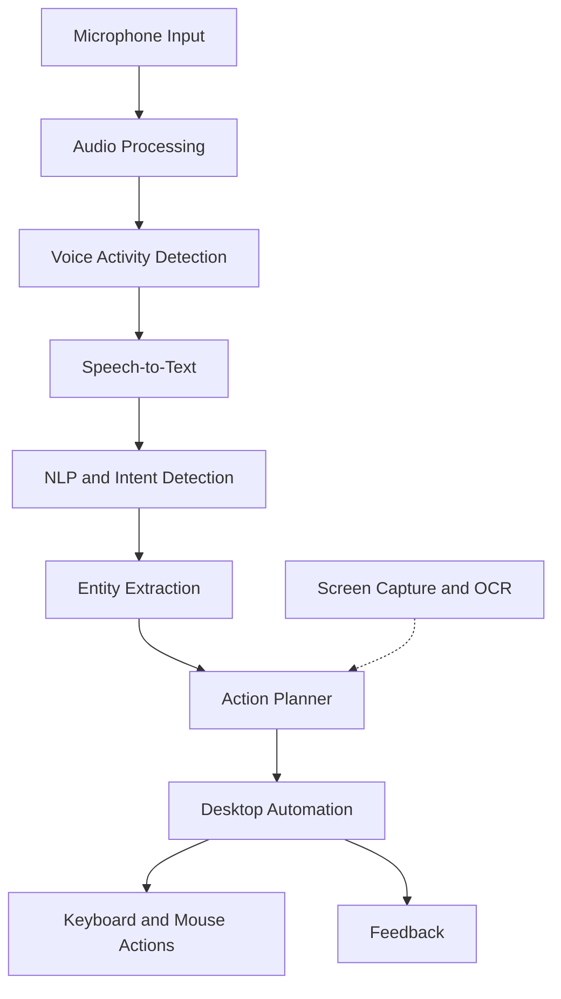

# Voice-Controlled System 🎙️

### An AI-Powered Desktop Automation Assistant

A Python-based desktop assistant that lets users interact with their computer through natural voice commands. It combines speech recognition, natural language processing, task planning, computer automation, and visual understanding to make desktop interaction more intuitive and hands-free.

The project is designed around a modular architecture, making it easier to develop, test, and extend individual components independently.

[**View Repository**](https://github.com/Anshul-sys32/Voice-Controlled-System)

---

## ✨ Features

- **Voice Input:** Capture spoken commands through a microphone.
- **Speech Recognition:** Convert speech into text using Whisper-based transcription.
- **Natural Language Understanding:** Analyze commands, identify intents, and extract relevant entities.
- **Intelligent Task Planning:** Organize recognized commands into actionable steps.
- **Desktop Automation:** Perform supported keyboard and mouse interactions programmatically.
- **Visual Understanding:** Capture screen content and use OCR to identify visible text.
- **Audio Processing:** Apply voice activity detection, buffering, and optional noise reduction.
- **Feedback System:** Provide user feedback through the project's feedback components.
- **Command Memory:** Includes components for command history and user preferences.
- **Modular Design:** Keep audio, NLP, planning, vision, and automation logic separated.

> **Project status:** Under active development. Available functionality depends on the implementation and configuration of individual modules.

## 🧠 How It Works

The assistant follows a processing pipeline that transforms spoken instructions into desktop actions.



1. **Capture:** Receive audio from the microphone.
2. **Process:** Buffer audio, detect speech, and optionally reduce background noise.
3. **Transcribe:** Convert speech into text.
4. **Understand:** Identify the user's intent and extract command parameters.
5. **Plan:** Determine the appropriate action or sequence of actions.
6. **Execute:** Use supported automation tools to interact with the desktop.
7. **Observe and respond:** Use visual information and feedback components where supported.

## 🛠️ Technology Stack

| Component | Technologies |
|---|---|
| Language | Python |
| Speech recognition | Faster-Whisper |
| Natural language processing | spaCy and custom command-processing modules |
| Audio processing | PyAudio, SoundDevice, and related audio libraries |
| Noise reduction | RNNoise-based processing |
| Computer vision | OpenCV, OCR, and screen capture utilities |
| Desktop automation | PyAutoGUI-compatible utilities and platform-specific automation tools |
| Machine learning | PyTorch and supporting ML libraries |
| Testing | Python testing utilities |

The exact runtime requirements depend on the operating system, installed libraries, and selected configuration.

## 📂 Project Structure

```text
Voice-Controlled-System/
├── assets/
│   └── icons/
├── audio/
│   ├── mic_input.py
│   ├── noise_reduction.py
│   ├── speech_buffer.py
│   └── vad.py
├── automation/
│   ├── mouse_controller.py
│   └── ...
├── feedback/
├── learning/
├── nlp/
│   ├── command_parser.py
│   ├── entity_extractor.py
│   └── intent_classifier.py
├── planner/
│   └── action_planner.py
├── speech_to_text/
│   └── whisper_stt.py
├── tests/
├── utils/
├── vision/
│   ├── ocr_reader.py
│   └── screen_capture.py
├── config.py
├── main.py
├── requirements.txt
├── .gitignore
└── README.md
```

### Module Overview

- **`audio/`** — Microphone input, audio buffering, voice activity detection, and noise reduction.
- **`speech_to_text/`** — Speech transcription and related processing.
- **`nlp/`** — Command interpretation, intent classification, and entity extraction.
- **`planner/`** — Planning actions based on interpreted commands.
- **`automation/`** — Desktop interaction and keyboard/mouse control.
- **`vision/`** — Screen capture, OCR, and visual information processing.
- **`feedback/`** — User-facing feedback components.
- **`learning/`** — Command memory and user preference components.
- **`utils/`** — Shared utilities, logging, timing, and supporting functionality.
- **`tests/`** — Automated tests and component-level checks.
- **`config.py`** — Central configuration.
- **`main.py`** — Application entry point.

*Some directories may contain additional modules beyond those listed above.*

## 🚀 Getting Started

### Prerequisites

Before running the project, make sure you have:

- Python 3.11 recommended.
- Git.
- A working microphone and audio input permissions.
- The system libraries required by your audio and desktop automation dependencies.
- A compatible desktop environment.

### 1. Clone the repository

```bash
git clone https://github.com/Anshul-sys32/Voice-Controlled-System.git
cd Voice-Controlled-System
```

### 2. Create a virtual environment

**Linux / macOS**

```bash
python3.11 -m venv .venv
source .venv/bin/activate
```

**Windows PowerShell**

```powershell
py -3.11 -m venv .venv
.\.venv\Scripts\Activate.ps1
```

### 3. Install dependencies

Upgrade pip and install the project's requirements:

```bash
python -m pip install --upgrade pip
python -m pip install -r requirements.txt
```

Some packages, particularly audio processing and desktop automation libraries, may require additional operating-system packages or development headers.

For GPU acceleration, ensure your PyTorch and speech-recognition runtime are compatible with your hardware and drivers.

### 4. Configure the application

Review `config.py` and any configuration options used by the individual modules.

Make sure your microphone, audio dependencies, and desktop automation environment are configured correctly before execution.

### 5. Run the assistant

From the repository root, execute:

```bash
python main.py
```

Follow the application's console output and prompts. If the application fails to initialize, check the installed dependencies, configuration, microphone permissions, and platform-specific automation requirements.

## 🧪 Testing

Run the project's tests using:

```bash
python -m pytest
```

If `pytest` is not installed in your environment, install it separately before running the command.

Test results may vary depending on available audio devices, display sessions, operating-system permissions, and external model resources.

## ⚙️ Compatibility and Performance

The project uses several components that interact with the host operating system.

- **CPU:** Speech recognition and vision workloads can be computationally intensive.
- **GPU:** Acceleration may be available depending on the installed ML runtime and supported hardware.
- **Audio:** Microphone access and compatible audio drivers are required for live voice input.
- **Desktop environment:** Mouse, keyboard, and screen-control behavior can vary between Windows, Linux, macOS, and different display systems.
- **Models:** Model files may need to be downloaded or configured before first use.

The goal is to support responsive, customizable desktop automation. Actual performance and offline capabilities depend on the configured models and dependencies.

## 🔒 Security and Privacy

Desktop automation can perform actions with the permissions of the current user.

- Review commands before enabling actions that modify files or system settings.
- Avoid running the assistant with unnecessary administrator or root privileges.
- Do not commit API keys, credentials, private logs, or personal configuration data.
- Review screen-capture and command-history behavior before using the application with sensitive information.
- Test automation workflows in a safe environment before relying on them.

## 🗺️ Future Improvements

Potential directions for further development include:

- More reliable streaming speech recognition and command handling.
- Context-aware, multi-step task execution.
- Improved on-screen text and icon recognition.
- Better recovery from failed or ambiguous commands.
- Expanded application and desktop environment support.
- User-configurable automation workflows.
- More comprehensive unit and integration testing.
- Improved command learning and personalization.

## 🤝 Contributing

Contributions, bug reports, and ideas are welcome.

1. Fork the repository.
2. Create a feature branch.
3. Make your changes and test them.
4. Commit your changes with a descriptive message.
5. Open a pull request describing the changes.

Please avoid committing model weights, virtual environments, credentials, or personal data.

## 📜 License

This project is distributed under the **GNU General Public License v3.0 (GPL-3.0)**. See [`LICENSE`](LICENSE) for the full license text.

## 👨‍💻 Author

**Anshul Chauhan**

- GitHub: [@Anshul-sys32](https://github.com/Anshul-sys32)
- Project: [Voice-Controlled-System](https://github.com/Anshul-sys32/Voice-Controlled-System)

---

*Built with Python, AI, and a goal of making desktop interaction more natural.*
